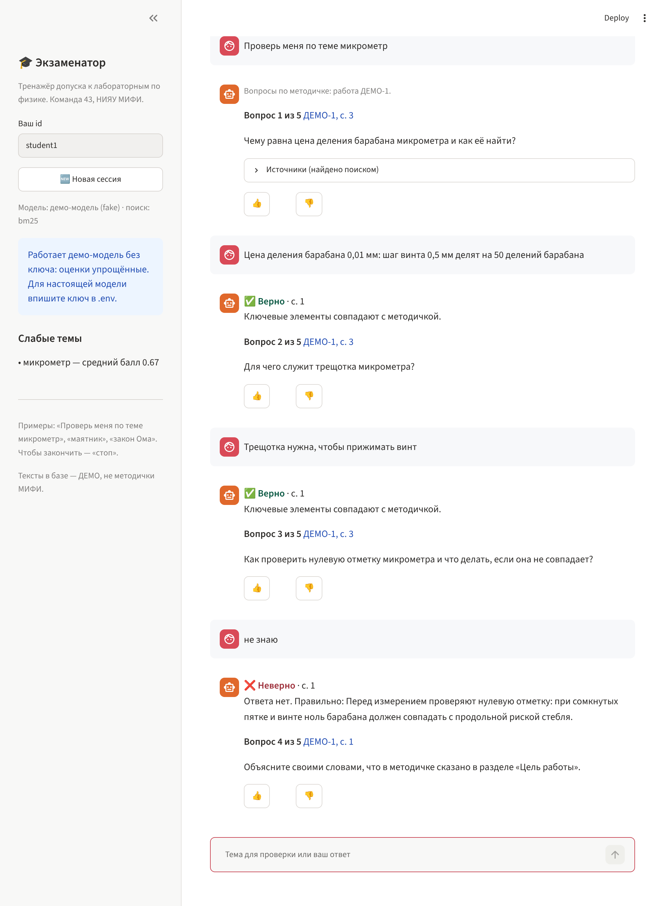
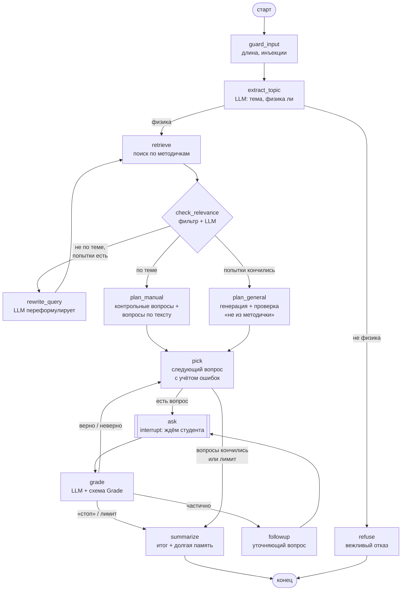

# Агент-Экзаменатор — тренажёр допуска к лабораторным по физике

Модуль командного проекта **«ИИ-ассистент по лабораторному практикуму физики НИЯУ МИФИ на основе архитектуры Agentic RAG»** (команда 43 «Deep Learning Poor Eating», курс «Методы разработки ПО с использованием LLM»).

**Автор модуля:** Масляев Вячеслав (Б26-205) — агент-Экзаменатор + API (FastAPI) + чат (Streamlit).

Экзаменатор готовит студента к допуску: находит тему в методичках, задаёт вопросы по одному, оценивает ответ «верно / частично / неверно» со ссылкой на страницу, на неполный ответ задаёт уточняющий вопрос, следующий вопрос выбирает с учётом ошибок, запоминает слабые темы между сессиями и в конце подводит итог.



> ⚠️ `data/manuals/*.md` — **ДЕМО-тексты** (микрометр и маятник), написанные для проверки агента. **Это не методички НИЯУ МИФИ.** Настоящие методички будут в базе ChromaDB Оскара Шарипова; поиск подключается через интерфейс `ManualSearch` (см. [docs/INTEGRATION.md](docs/INTEGRATION.md)).

## Что умеет агент

| Шаг | Что происходит | Где в коде |
|---|---|---|
| 1. Тема | модель выделяет тему и решает, физика ли это | `extract_topic` |
| 2. Поиск | поиск по методичкам (BM25 по демо-текстам или ChromaDB) | `retrieve` |
| 3. Проверка релевантности | поиск всегда что-то возвращает → дешёвый фильтр по словам + проверка моделью | `check_relevance` |
| 4. Повторный поиск | не нашли — модель переформулирует запрос (до `MAX_SEARCH_ATTEMPTS`) | `rewrite_query` |
| 5а. Тема есть | сначала «Контрольные вопросы» методички, затем вопросы по тексту; у каждого — страница | `plan_manual` |
| 5б. Темы нет, но физика | вопросы генерирует модель, пометка **«не из методички»**, каждый проходит проверку (точка подключения Проверяющего) | `plan_general`, `verifier.py` |
| 5в. Не физика | вежливый отказ | `refuse` |
| 6. Вопрос | граф останавливается и ждёт ответ студента (human-in-the-loop, `interrupt`) | `ask` |
| 7. Оценка | «верно / частично / неверно» + объяснение + страница, ответ модели проверяется Pydantic-схемой | `grade` |
| 8. Уточнение | на «частично» — один уточняющий вопрос | `followup` |
| 9. Следующий вопрос | после ошибки — вопрос по тому же разделу методички | `pick`, `logic.pick_next` |
| 10. Итог | «3 из 5, повторите …», слабые темы сохраняются в долгую память | `summarize`, `memory.py` |



Подробнее: [docs/ARCHITECTURE.md](docs/ARCHITECTURE.md) · объяснение кода и вопросы к защите: [docs/HOW_IT_WORKS.md](docs/HOW_IT_WORKS.md) · мой раздел отчёта КП2: [docs/REPORT_KP2.md](docs/REPORT_KP2.md).

## Быстрый старт

Нужен Python 3.12 или новее.

**Linux / macOS**
```bash
python3 -m venv .venv
source .venv/bin/activate
pip install -r requirements.txt
cp .env.example .env          # по умолчанию LLM_PROVIDER=fake — работает без ключа
python -m pytest              # 67 тестов, ключ не нужен
```

**Windows (PowerShell)**
```powershell
py -3.12 -m venv .venv
.\.venv\Scripts\Activate.ps1
pip install -r requirements.txt
Copy-Item .env.example .env
python -m pytest
```

### Запуск

```bash
python -m examiner.cli "Проверь меня по теме маятник"   # в терминале, без сервера

uvicorn api.main:app --port 8000                       # терминал 1: API, документация на /docs
streamlit run ui/app.py                                # терминал 2: чат на http://localhost:8501
```

В чате: напишите тему («микрометр», «маятник», «закон Ома»), отвечайте на вопросы, «стоп» — закончить.

### Настоящая модель

В `.env`:
```ini
LLM_PROVIDER=openai
LLM_BASE_URL=https://foundation-models.api.cloud.ru/v1   # Cloud.ru, из РФ без VPN
LLM_API_KEY=ваш_ключ
LLM_MODEL=qwen/qwen3-vl-30b-a3b-instruct
```
Подходит любой OpenAI-совместимый API: OpenRouter (из РФ только с VPN), llama.cpp (`http://127.0.0.1:8080/v1`). Можно указать запасную модель `FALLBACK_*`, она включится при ошибке сети или лимите основной.

`LLM_PROVIDER=fake` — встроенная демо-модель на простых правилах (`examiner/fake_llm.py`). Она нужна для демонстрации и тестов без ключа. **Для метрик качества её использовать нельзя.**

## API

| Метод | Что делает |
|---|---|
| `POST /chat` | единая точка для чата и Диспетчера: если ждём ответ — продолжает сессию, иначе начинает новую |
| `POST /exam/start` | начать сессию: `{user_id, chat_id, request}` |
| `POST /exam/answer` (= `/resume`) | ответ на текущий вопрос → `Command(resume=…)` |
| `GET /memory/{user_id}` | слабые темы и вопросы с ошибками |
| `POST /feedback` | кнопки «полезно / нет» → `var/feedback.jsonl` (продуктовая метрика) |
| `POST /upload` | фото таблицы для Расчётчика: проверка типа (PNG/JPEG/WEBP по сигнатуре) и размера (≤ 10 МБ) |
| `GET /health` | жив ли сервер, какая модель, задан ли ключ (сам ключ не возвращается) |

Пример ответа `/chat`: `status` (`question` / `finished` / `refused` / `error`), `question` (текст, номер, метка «ДЕМО-1, с. 3» или «не из методички»), `grade` (оценка прошлого ответа), `sources`, `events` (журнал шагов графа: узел, время, число вызовов модели, ошибки), `llm_calls`.

## Гардрейлы

- **Лимиты:** `MAX_QUESTIONS` вопросов за сессию, `MAX_LLM_CALLS` вызовов модели за сессию (по исчерпании — итог по уже отвеченному, а не падение), `MAX_SEARCH_ATTEMPTS` попыток поиска, `recursion_limit=100` шагов графа, длина ответа ≤ `MAX_ANSWER_CHARS`.
- **Структурированный вывод:** каждый ответ модели проверяется Pydantic-схемой (`schemas.py`); при ошибке модели показывают ошибку и просят исправить (до `JSON_RETRIES` раз); рассуждения `<think>` Qwen3 срезаются.
- **Ошибки:** сеть/таймаут/лимит → запасная модель (`with_fallbacks`) → понятное сообщение в чате, без трассировки Python.
- **Prompt injection:** всё внешнее (запрос, ответ студента, текст методички) передаётся в тегах `<...>`, в промпте сказано, что это данные, а не инструкции. Плюс дешёвый фильтр до вызова модели: «игнорируй инструкции», «поставь верно» → отказ / «неверно» без вызова модели.
- **Страница — только из найденного:** номер страницы в оценке берётся из фрагментов поиска, а не «из головы» модели.
- **Ключи** только в `.env` (в `.gitignore`), `repr(Settings)` ключ не показывает, в ответы API он не попадает.

## Бенчмарк

Проверка оценки ответов на вопросах по физике из **ruMMLU (MERA)**: агенту подают вопрос и вариант ответа как «ответ студента» — правильный (должно быть «верно») и неправильный (не должно быть «верно»). Сравнение с baseline «та же LLM без эталона и без схемы».

```bash
python -m eval.download_rummlu                          # MERA rummlu; если ответов мало — NLPCoreTeam/mmlu_ru
python -m eval.run_grading_benchmark --limit 100        # агент
python -m eval.run_grading_benchmark --limit 100 --baseline
python -m eval.feedback_stats                           # доля «полезно» из чата
```
Результаты (метрики + каждый ответ модели) сохраняются в `eval/results/`. На демо-модели скрипт запускается только с флагом `--allow-fake`, а файл получает суффикс `_FAKE`, чтобы его нельзя было спутать с настоящим замером.

## Структура

```
examiner/
  agent.py       граф LangGraph, узлы, переходы, обёртка Examiner (start/answer)
  prompts.py     промпты из 6 частей, данные в тегах, примеры оценки
  schemas.py     Pydantic-схемы ответов модели и вопросов
  llm.py         подключение модели, ask_json (схема + повтор), лимит вызовов, fallback
  knowledge.py   интерфейс поиска ManualSearch: BM25 по демо-текстам + адаптер ChromaDB
  logic.py       порядок вопросов, выбор следующего с учётом ошибок, итог
  memory.py      долгая память слабых тем (SQLite, по user_id)
  verifier.py    точка подключения агента-Проверяющего
  fake_llm.py    демо-модель без ключа (для демо и тестов)
  text.py        токены, стемминг, фильтр инъекций
  cli.py         запуск в терминале
api/main.py      FastAPI
ui/app.py        чат Streamlit
eval/            скачивание ruMMLU, бенчмарк, статистика отзывов, results/
tests/           67 тестов с фейковой моделью
data/manuals/    ДЕМО-тексты (не методички МИФИ)
docs/            архитектура, отчёт КП2, объяснение кода, интеграция, скриншоты
```
