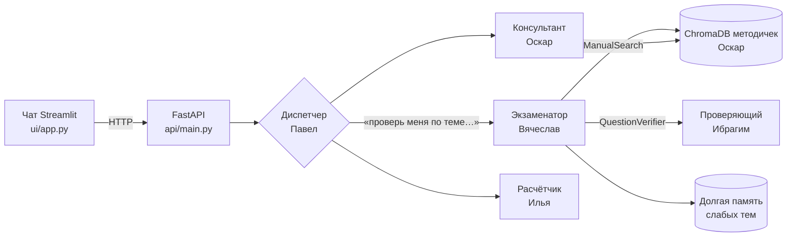
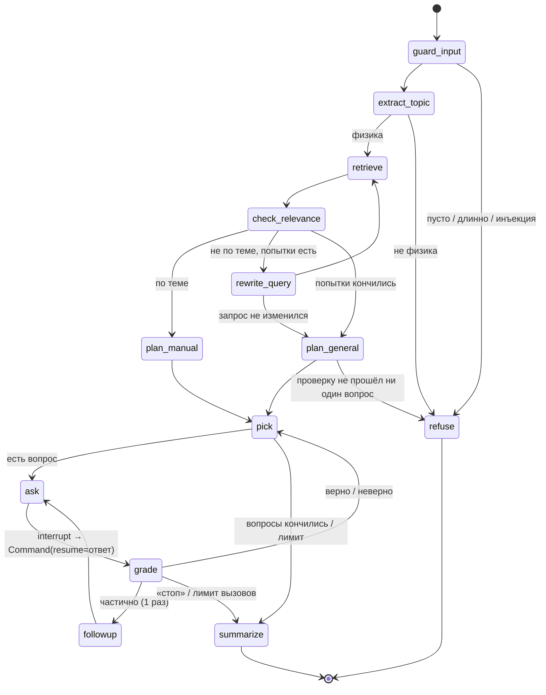
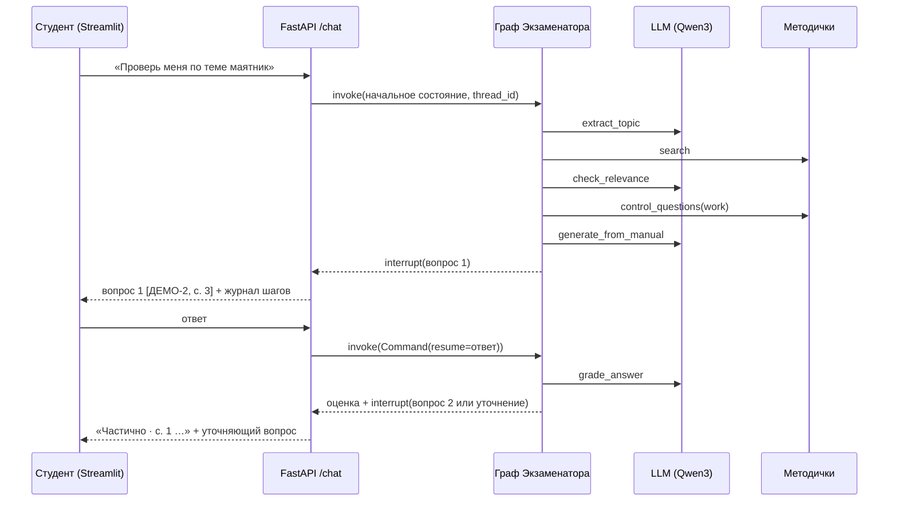

# Архитектура Экзаменатора

## Место в общей системе команды 43



Пока общего графа нет, API вызывает Экзаменатора напрямую (`POST /chat`). Диспетчер Павла сможет вызывать тот же `/chat` или встроить граф Экзаменатора как подграф (`build_graph(deps)` возвращает скомпилированный граф).

Точки подключения к модулям коллег (интерфейсы, а не конкретные классы):

| Что | Интерфейс | Сейчас | Потом |
|---|---|---|---|
| Поиск по методичкам | `ManualSearch.search(query, k, work)` и `.control_questions(work)` | `BM25ManualSearch` по `data/manuals/*.md` (ДЕМО) | `ChromaManualSearch` над коллекцией Оскара (`SEARCH_BACKEND=chroma`) |
| Проверка вопросов «не из методички» | `QuestionVerifier.verify(question, run)` → `VerifierVerdict(ok, reason)` | `LLMQuestionVerifier` — отдельный вызов модели-проверяющего | агент-Проверяющий Ибрагима |
| Вход от Диспетчера | `POST /chat {user_id, chat_id, message}` | вызывает Экзаменатора | Диспетчер решает, кому отдать |
| Модель | `invoke(list[BaseMessage]) -> AIMessage` | `ChatOpenAI(base_url=…)` + `with_fallbacks` | общий `llm.py` команды |

Формат ссылки на методичку совпадает с общим контрактом из плана команды: `Source(work, page, section, quote)` (+ `title`).

## Граф LangGraph

Узлы и переходы — в `examiner/agent.py`. Сплошные стрелки — безусловные переходы, у остальных узлов условные (`add_conditional_edges`). Общие остановки для всех узлов: ошибка модели → `END` с понятным сообщением; исчерпан лимит вызовов или студент написал «стоп» → `summarize`.



Полную схему из самого кода можно получить так:
```python
from examiner import Examiner, ExaminerDeps
print(Examiner(ExaminerDeps.from_settings()).graph.get_graph().draw_mermaid())
```

### Почему это агент, а не «простой RAG»

- **Ветвление по решению модели:** физика или нет; найдено по теме или нет; ответ полный или нет.
- **Проверка себя:** после поиска модель проверяет релевантность найденного (поиск возвращает top-k всегда), сгенерированные вопросы проверяются отдельным вызовом до показа студенту.
- **Повторный поиск** с переформулировкой запроса.
- **Human-in-the-loop:** граф останавливается на `interrupt()` и продолжается с ответом студента.
- **Память:** краткосрочная (checkpointer по `thread_id`) и долгая (слабые темы и вопросы с ошибками по `user_id`).
- **Выбор следующего шага:** уточняющий вопрос, вопрос по слабому разделу, итог.

## Состояние графа (`ExamState`)

| Поле | Зачем |
|---|---|
| `user_id`, `chat_id` | кто и в каком чате; `thread_id = "<user_id>:<chat_id>"` |
| `request`, `topic`, `is_physics`, `search_query` | запрос и разбор темы |
| `hits`, `search_attempts`, `relevant`, `work` | результаты поиска и проверки |
| `queue`, `asked_ids`, `current` | очередь вопросов, заданные, текущий |
| `answer`, `last_grade`, `history` | ответы и оценки |
| `llm_calls` | счётчик вызовов модели (лимит на сессию) |
| `status`, `final_message`, `stopped_early`, `notice` | итог и сообщения студенту |
| `events` | журнал шагов (reducer `operator.add`): узел, время, вызовы модели, ошибки — для наблюдаемости и статуса в чате |

## Память

| Вид | Где | Ключ | Что хранит |
|---|---|---|---|
| Краткосрочная | `InMemorySaver` (checkpointer LangGraph) | `thread_id` | всё состояние сессии; позволяет остановиться на вопросе и продолжить |
| Долгая | SQLite `var/memory.sqlite3` (`memory.py`) | `user_id` | средний балл по темам, вопросы с ошибками; в новой сессии первыми идут вопросы, где были ошибки |

## Один ход через API



До первого вопроса — 3 вызова модели (тема, релевантность, генерация вопросов по тексту), на каждый ответ — 1 вызов (оценка). «Не знаю», «стоп» и попытки инъекции обрабатываются кодом без вызова модели. Если тема не найдена, добавляются переформулировка (+1), генерация (+1) и проверка каждого вопроса (+1 на вопрос).
